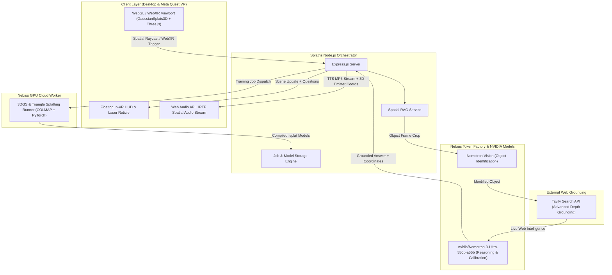

# 🛸 Splatris: Spatial 3D Gaussian Splatting & Embodied AI Agent

[](https://opensource.org/licenses/Apache-2.0)
[](https://www.nvidia.com/)
[](https://tokenfactory.nebius.com/)
[](https://tavily.com/)
[](https://www.w3.org/TR/webxr/)

> **Submitted to the Nebius × NVIDIA Global AI Hackathon**  
> **Track:** Track 2 — Best Apps and Agents Track  
> **Bonus Award Nomination:** Best Use of Tavily

---

## 🌟 Executive Summary

**Splatris** is a full-stack spatial intelligence platform that transforms raw smartphone videos into interactive, photorealistic **3D Gaussian Splats (3DGS)** and **Triangle Splatting** environments. It connects the 3D reconstructed scene with an embodied **Spatial AI Guide** powered by **NVIDIA Nemotron-3-Ultra** on **Nebius Token Factory**, grounded with real-time web intelligence via **Tavily Search**, and experienced immersively via **WebXR on Meta Quest** with positional 3D spatial audio.

Whether exploring historical artifacts, inspecting industrial digital twins, or analyzing complex equipment, Splatris allows users to step inside the 3D scene, point at physical elements with laser reticles, ask complex contextual questions, and hear articulate answers spatialized in 3D audio directly from the object's real-world coordinates.

---

## 🚀 Key Features

### 1. 🎥 Multimodal Video & Image Ingestion Pipeline
- **Pre-Flight AI Quality Audit**: Evaluates uploaded videos for blur, camera motion smoothness, frame count, and lighting quality using `nvidia/Nemotron-3-Ultra` before dedicating GPU resources.
- **Autonomous Training Calibration**: Nemotron reasons over scene camera metadata, field of view, and frame density to calculate optimal 3DGS hyper-parameters (learning rates, densification iterations, covariance scaling).
- **Dual Pipeline Architecture**: Seamlessly switch between **Standard 3DGS** (Gaussian Splatting) and **Triangle Splatting** meshes for high-fidelity spatial fidelity.
- **Single Image 3D Lifting (Image2Splat)**: Instant depth-conditioned 3D splat generation from a single photograph.

### 2. 🧠 Autonomous Spatial RAG with NVIDIA Nemotron & Tavily
- **Interactive 3D Raycasting**: Click on any object in desktop 3D view or point with the VR controller to cast a spatial ray through 3D space.
- **Object Identification via Nemotron Vision**: Identifies target geometry from training video frames and bounding crops.
- **Real-Time Web Grounding via Tavily API**: Queries Tavily with advanced search depth to retrieve comprehensive, up-to-date historical, technical, and cultural specifications for the identified object.
- **Spatial Reasoning via Nemotron-3-Ultra**: Synthesizes grounded answers tailored specifically to the user's 3D coordinates and perspective, while dynamically formulating 2–3 follow-up exploratory questions.

### 3. 🥽 Immersive WebXR & Spatial Audio (Meta Quest 3 / Pro)
- **Controller-Hand Separation**:
  - **Right Controller Trigger**: Exclusively dedicated to 3D scene scanning and Tavily object grounding.
  - **Left Controller Trigger**: Exclusively dedicated to in-VR HUD panel selection (Mute toggle, Question card selection).
- **In-VR Laser Reticle**: Real-time laser pointer target dot projected onto the floating HUD panel for pinpoint interaction accuracy.
- **Dynamic Glassmorphic HUD**: Displays multi-line titles, complete questions without truncation, and adaptive response text.
- **Web Audio HRTF Spatial Audio Queue**: Chunks responses into fluid, non-overlapping natural speech streams piped through WebXR AudioContext and positioned directly at the 3D target coordinates.
- **Grip HUD Toggle & Clean Exit**: Squeeze Left/Right Grip to open/close the panel; press [A] or [X] to smoothly fade out audio and exit WebXR.

---

## 🏗️ System Architecture



---

## 💡 How NVIDIA Nemotron & Nebius Token Factory Accelerate Splatris

1. **`nvidia/Nemotron-3-Ultra-550b-a55b` via Nebius Token Factory**:
   - **Hyper-Parameter Calibration**: Standard 3DGS training fails if camera trajectory or lighting varies. Nemotron evaluates frame audit metrics and dynamically outputs optimal densification iterations and prune thresholds.
   - **Spatial RAG Reasoning**: When a user queries an object from a specific 3D location, Nemotron interprets the 3D camera coordinates, bounding box context, and Tavily grounding data to deliver a conversational, spoken-friendly answer tailored to that exact viewpoint.
   - **High-Throughput Token Factory Speed**: Ultra-low time-to-first-token (TTFT) via Nebius Token Factory enables real-time voice streaming inside WebXR without immersion-breaking latency.

2. **Nemotron Vision via Nebius Token Factory**:
   - Performs zero-shot object identification by projecting 3D intersection points back onto the closest camera frustum frame crop.

3. **Nebius GPU Cloud**:
   - Powers the high-performance CUDA pipeline for COLMAP Structure-from-Motion and differentiable Gaussian rasterization.

---

## 🔍 How Tavily Powers Grounded Spatial Intelligence

Splatris integrates the **Tavily Search API** (`search_depth: 'advanced'`) directly into its runtime 3D raycasting pipeline:
- When an object (e.g., T-54/55 Main Battle Tank) is selected in 3D space, Tavily retrieves verified production history, engineering specifications, armor composition, and combat deployments.
- Tavily's structured responses supply dynamic **Suggested Questions** that are converted into clickable glassmorphic cards in the WebXR HUD, allowing the user to drill down into technical details with their left controller trigger.

---

## 🛠️ Quick Start & Installation

### Prerequisites
- **Node.js**: v18.0.0 or higher
- **NPM**: v9.0.0 or higher
- **API Keys**:
  - `NEBIUS_API_KEY` (Nebius Token Factory)
  - `TAVILY_API_KEY` (Tavily AI Search)

### 1. Clone & Install
```bash
git clone https://github.com/memetcircus/splatris.git
cd splatris
npm install
```

### 2. Configure Environment Variables
Copy `.env.example` to `.env` and supply your credentials:
```bash
cp .env.example .env
```

Edit `.env`:
```env
PORT=3000
NEBIUS_API_KEY=your_nebius_token_factory_key
NEBIUS_BASE_URL=https://api.tokenfactory.nebius.com/v1
TAVILY_API_KEY=your_tavily_api_key
NEBIUS_REMOTE_GPU_URL=http://89.169.112.193:8000
```

### 3. Run Locally
```bash
npm start
```
Open **`http://localhost:3000`** in any modern desktop browser (Chrome, Edge, Safari) or in the **Meta Quest Browser** for WebXR.

---

## ☁️ 1-Click Deployment on Render.com (Free Tier)

Splatris includes pre-packaged demo 3D splat models in `uploads/models/`, allowing instant deployment without running a GPU worker:

1. Fork or push this repository to your GitHub account.
2. Log in to [Render.com](https://render.com/) and click **New +** → **Web Service**.
3. Select the `splatris` repository.
4. Configure the service settings:
   - **Environment**: `Node`
   - **Build Command**: `npm install`
   - **Start Command**: `npm start`
5. In the **Environment Variables** tab, add:
   - `NEBIUS_API_KEY` = `your_nebius_api_key`
   - `NEBIUS_BASE_URL` = `https://api.tokenfactory.nebius.com/v1`
   - `TAVILY_API_KEY` = `your_tavily_api_key`
6. Click **Deploy Web Service**. Render will generate a permanent, secure HTTPS URL (e.g., `https://splatris.onrender.com`).

---

## 🎮 WebXR Meta Quest Controls Cheat Sheet

| Input | Controller | Action |
| :--- | :--- | :--- |
| **Right Trigger** | Right Controller | **Point & Pull**: 3D Raycast Scan on target object (queries Tavily & Nemotron). |
| **Left Trigger** | Left Controller | **Point & Pull**: Interacts with HUD Panel (toggles Mute button or selects Question 1, 2, 3). |
| **Left / Right Grip** | Either Hand | **Squeeze**: Toggles floating in-VR HUD open or closed. |
| **Button [A] / [X]** | Right [A] / Left [X] | **Press**: Smoothly fades out audio and exits WebXR session. |
| **Left Thumbstick** | Left Hand | **Move**: Smooth 6DoF locomotion (forward, backward, strafe). |
| **Right Thumbstick** | Right Hand | **Turn & Elevate**: Snap turning and vertical flight. |

---

## 📜 License

This project is licensed under the **Apache License 2.0**. See the [LICENSE](LICENSE) file for complete details.

---

## 👥 Hackathon Team & Acknowledgments

- **Developed for:** Nebius × NVIDIA Global AI Hackathon (2026)
- **Special Thanks:**
  - **NVIDIA** for the open-source Nemotron family (`nvidia/Nemotron-3-Ultra`).
  - **Nebius** for Token Factory inference acceleration and AI Cloud infrastructure.
  - **Tavily** for autonomous web search and grounding APIs.
