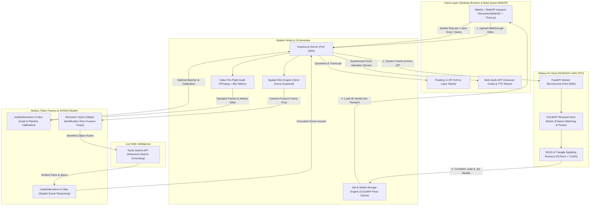
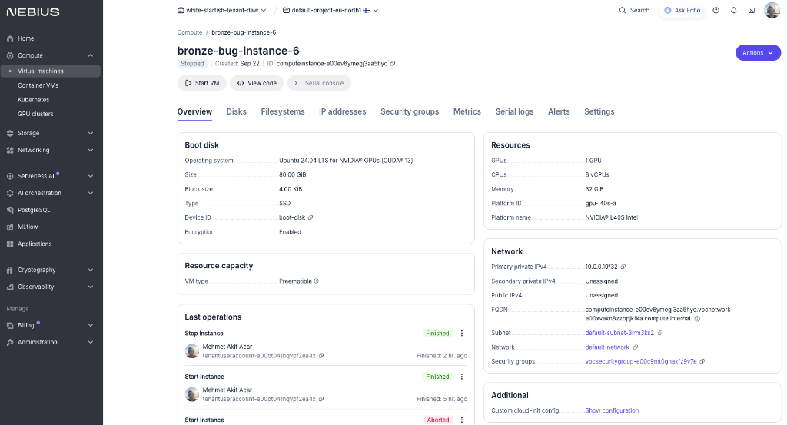

# 🛸 Splatris: Spatial 3D Gaussian Splatting & Embodied AI Agent

[](https://opensource.org/licenses/Apache-2.0)
[](https://www.nvidia.com/)
[](https://tokenfactory.nebius.com/)
[](https://tavily.com/)
[](https://www.w3.org/TR/webxr/)

---

## 🌟 Executive Summary

**Splatris** is a full-stack spatial intelligence platform that transforms raw smartphone walkthrough videos into interactive, photorealistic **3D Gaussian Splats (3DGS)** and **Triangle Splatting** environments. It connects the 3D reconstructed scene with an embodied **Spatial AI Guide** powered by **NVIDIA Nemotron-3-Ultra** on **Nebius Token Factory**, grounded with real-time web intelligence via **Tavily Search**, and experienced immersively via **WebXR on Meta Quest** with natural voice narration.

Whether exploring historical artifacts, inspecting industrial digital twins, or analyzing complex equipment, Splatris allows users to step inside the 3D scene, point at physical elements with laser reticles, ask contextual questions, and hear articulate answers narrated clearly in the audio guide.

---

## 🚀 Key Features

### 1. 🎥 Automated Video Ingestion & Photogrammetry Pipeline
- **Pre-Flight AI Quality Audit**: Evaluates uploaded videos for motion blur, camera smoothness, frame count, and lighting quality using `nvidia/Nemotron-3-Ultra` before dedicating GPU resources.
- **Autonomous Training Calibration**: Nemotron reasons over scene camera metadata, field of view, and frame density to calculate optimal 3DGS hyper-parameters (learning rates, densification iterations, covariance scaling).
- **Dual Pipeline Architecture**: Seamlessly switch between **Standard 3DGS** (Gaussian Splatting) for maximum desktop photorealism and **Triangle Splatting** for lightweight, high-FPS mobile VR performance.
- **Fast Pipeline Switch (<90s)**: Reuses cached COLMAP camera poses to convert existing video scenes into Triangle Splats in under 90 seconds without re-running Structure-from-Motion.

### 2. 🧠 Autonomous Spatial RAG with NVIDIA Nemotron & Tavily
- **Interactive 3D Raycasting**: Click on any object in desktop 3D view or point with the VR controller to cast a spatial ray through 3D space.
- **Object Identification via Nemotron Vision**: Identifies target geometry from training video frames and bounding crops.
- **Real-Time Web Grounding via Tavily API**: Queries Tavily with advanced search depth to retrieve comprehensive, up-to-date historical, technical, and cultural specifications for the identified object.
- **Spatial Reasoning via Nemotron-3-Ultra**: Synthesizes grounded answers tailored specifically to the user's perspective, with strict guardrails ensuring questions remain strictly focused on the active 3D space.

### 3. 🥽 Immersive WebXR on Meta Quest (Quest 3 / Pro)
- **Controller-Hand Separation**:
  - **Right Controller Trigger**: Exclusively dedicated to 3D scene scanning and Tavily object grounding.
  - **Left Controller Trigger**: Exclusively dedicated to in-VR HUD panel selection (Mute toggle, Question card selection).
- **In-VR Laser Reticle**: Real-time laser pointer target dot projected onto the floating HUD panel for pinpoint interaction accuracy.
- **Dynamic Glassmorphic HUD**: Displays multi-line titles, complete questions without truncation, and adaptive response text.
- **Conversational Voice Guide**: Streams clear natural speech narration and conversational guidance for the reconstructed 3D space.
- **Grip HUD Toggle & Clean Exit**: Squeeze Left/Right Grip to open/close the panel; press [A] or [X] to smoothly fade out audio and exit WebXR.

---

## 🏗️ System Architecture



---

## ☁️ Nebius AI Cloud Infrastructure & Hardware Verification

Splatris offloads photogrammetry (COLMAP Structure-from-Motion), 3D Gaussian Splatting, and Triangle Splatting directly to an **NVIDIA® L40S GPU** instance provisioned on **Nebius AI Cloud**.

<div align="center">
  
  <p><em>Verified Nebius AI Cloud Compute Instance: <code>bronze-bug-instance-6</code> with NVIDIA® L40S GPU (48 GB GDDR6).</em></p>
</div>

### 🖥️ Provisioned Nebius Instance Specifications

| Parameter | Specification in Nebius AI Cloud |
| :--- | :--- |
| **Instance Name** | `bronze-bug-instance-6` |
| **Instance ID** | `computeinstance-e00ev6ymegj3aa5hyc` |
| **Project & Region** | `default-project-eu-north1` (`white-starfish-tenant-daw`) |
| **Platform ID / Name** | `gpu-l40s-a` / **NVIDIA® L40S Intel** (Ada Lovelace) |
| **Hardware Preset** | **1 GPU (48 GB GDDR6 VRAM), 8 vCPUs, 32 GiB System RAM** |
| **Capacity Type** | **Preemptible** (Cost-optimized high-throughput batch compute) |
| **Operating System** | **Ubuntu 24.04 LTS for NVIDIA® GPUs (CUDA® 13 / 12.4)** |
| **Disk Storage** | **80.00 GiB SSD** (`boot-disk`) |
| **Worker Service** | `splatris-worker.service` (FastAPI microservice listening on port 8000) |

> 📖 **Want to reproduce this setup?** Follow our step-by-step reproduction guide: [**docs/NEBIUS_GPU_SETUP.md**](docs/NEBIUS_GPU_SETUP.md).

---

## 💡 How NVIDIA Nemotron & Nebius Token Factory Accelerate Splatris

1. **`nvidia/Nemotron-3-Ultra-550b-a55b` via Nebius Token Factory**:
   - **Autonomous Pre-Flight Video Audit**: Evaluates video frame metrics (Laplacian blur, camera smoothness, coverage) and prevents wasting GPU compute on non-reconstructible footage.
   - **COLMAP Hyper-Parameter Calibration**: Automatically chooses between `sequential` and `vocab_tree` feature matching and tunes densification iterations based on scene complexity.
   - **Grounded Spatial Q&A with Strict Guardrails**: Interprets the user's perspective, camera coordinates, and Tavily grounding data. Employs a strict system prompt guardrail ensuring the AI exclusively answers questions related to the active 3D space.
   - **Ultra-Low Latency via Token Factory**: High-speed token generation enables real-time conversational voice guidance inside WebXR without immersion-breaking latency.

2. **Nemotron Vision via Nebius Token Factory**:
   - Performs zero-shot object identification by projecting 3D intersection points back onto the closest camera frustum frame crop.

3. **Nebius AI Cloud Dedicated GPU Compute**:
   - Powers the high-performance CUDA pipeline for COLMAP Structure-from-Motion and differentiable Gaussian rasterization via FastAPI `splatris-worker.service`.

---

## 🔍 How Tavily Powers Grounded Spatial Intelligence

Splatris integrates the **Tavily Search API** (`search_depth: 'advanced'`) directly into its runtime 3D raycasting and chat pipeline:
- When an object (e.g., T-54/55 Main Battle Tank or museum artifact) is queried in 3D space, Tavily retrieves verified production history, engineering specifications, and historical facts.
- The retrieved facts are fed into Nemotron-3-Ultra, ensuring every answer is factual, precise, and up-to-date rather than hallucinated.

---

## 🛠️ Quick Start & Installation

### Prerequisites
- **Node.js**: v18.0.0 or higher
- **NPM**: v9.0.0 or higher
- **API Keys**:
  - `NEBIUS_API_KEY` (Nebius Token Factory)
  - `TAVILY_API_KEY` (Tavily AI Search)

### 1. Clone & Install
```bash
git clone https://github.com/memetcircus/splatris.git
cd splatris
npm install
```

### 2. Configure Environment Variables
Copy `.env.example` to `.env` and supply your credentials:
```bash
cp .env.example .env
```

Edit `.env`:
```env
PORT=3000
NEBIUS_API_KEY=your_nebius_token_factory_key
NEBIUS_BASE_URL=https://api.tokenfactory.nebius.com/v1
TAVILY_API_KEY=your_tavily_api_key

# Optional: Remote Nebius GPU Worker (Leave blank to use pre-packaged demo models)
NEBIUS_GPU_ENDPOINT=http://<nebius-gpu-vm-ip>:8000
```

### 3. Run Locally
```bash
npm start
```
Open **`http://localhost:3000`** in any modern desktop browser (Chrome, Edge, Safari) or in the **Meta Quest Browser** for WebXR.

---

## ☁️ 1-Click Deployment on Render.com (Free Tier)

Splatris includes pre-packaged demo 3D splat models in `uploads/models/`, allowing instant deployment without running a GPU worker:

1. Fork or push this repository to your GitHub account.
2. Log in to [Render.com](https://render.com/) and click **New +** → **Web Service**.
3. Select the `splatris` repository.
4. Configure the service settings:
   - **Environment**: `Node`
   - **Build Command**: `npm install`
   - **Start Command**: `npm start`
5. In the **Environment Variables** tab, add:
   - `NEBIUS_API_KEY` = `your_nebius_api_key`
   - `NEBIUS_BASE_URL` = `https://api.tokenfactory.nebius.com/v1`
   - `TAVILY_API_KEY` = `your_tavily_api_key`
6. Click **Deploy Web Service**. Render will generate a permanent, secure HTTPS URL (e.g., `https://your-service-name.onrender.com`).

---

## 🎮 WebXR Meta Quest Controls Cheat Sheet

| Input | Controller | Action |
| :--- | :--- | :--- |
| **Right Trigger** | Right Controller | **Point & Pull**: 3D Raycast Scan on target object (queries Tavily & Nemotron). |
| **Left Trigger** | Left Controller | **Point & Pull**: Interacts with HUD Panel (toggles Mute button or selects Question 1, 2, 3). |
| **Left / Right Grip** | Either Hand | **Squeeze**: Toggles floating in-VR HUD open or closed. |
| **Button [A] / [X]** | Right [A] / Left [X] | **Press**: Smoothly fades out audio and exits WebXR session. |
| **Left Thumbstick** | Left Hand | **Move**: Smooth 6DoF locomotion (forward, backward, strafe). |
| **Right Thumbstick** | Right Hand | **Turn & Elevate**: Snap turning and vertical flight. |

---

## 🏛️ Benchmark Datasets & Attributions

For testing and demonstrating high-precision photogrammetry and loop-closure calibration, Splatris leverages the standard **M60 Tank** benchmark dataset from the renowned **Tanks and Temples** benchmark:

- **Dataset:** `M60` (Intermediate Category)
- **Source:** [Tanks and Temples: Benchmarking Large-Scale Scene Reconstruction](https://tanksandtemples.org/download/)
- **Citation:** Knapitsch, Park, Zhou, Qian, and Koltun, *ACM Transactions on Graphics (SIGGRAPH 2017)*.

---

## 📜 License

This project is licensed under the **Apache License 2.0**. See the [LICENSE](LICENSE) file for complete details.

